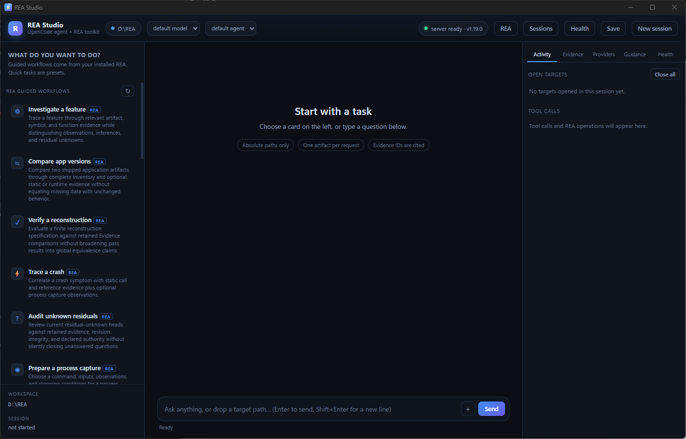

# REA Studio

A desktop app for talking to the OpenCode agent and driving the **REA**
reverse-engineering toolkit through a wizard, instead of remembering tool names
and prompt shapes.

- Electron shell + the official `@opencode-ai/sdk` client
- Reuses a healthy OpenCode server on `http://127.0.0.1:4096`, or starts one
- Injects the `GHIDRA_INSTALL_DIR` / `JAVA_HOME` from your OpenCode MCP config
  so REA's Ghidra provider works inside the app
- Wizard tasks build the prompt for you, then stream the agent's answer
- Workflow cards are generated from your installed REA (`rea guided-workflows`),
  so they never drift from the toolkit version
- A direct **REA console** runs any `rea` subcommand without spending an agent
  turn, with `--format`, `--token-limit`, `--filter-output` and `--timings`
- Live tool-call activity, open-target tracking, evidence-ID collection,
  evidence bundle actions, permission prompts, capability matrix, session
  history, model/agent pickers, file attachments, and a health panel with
  `rea doctor`

## Screenshot



## Requirements

| Thing | Expected |
|---|---|
| Node.js | 20+ (tested on 26) |
| OpenCode CLI | installed at `%APPDATA%\npm\node_modules\opencode-ai` |
| REA | registered as MCP server `rea` in `~/.config/opencode/opencode.jsonc` |
| Ghidra | optional, but needed for native PE decompilation |

The app does **not** install or configure any of these; it uses what
`rea setup --client opencode` already wrote.

## Install (Windows MSI)

```powershell
msiexec /i "D:\REA\rea-wizard\release\REA-Studio-1.2.2-x64.msi"
```

The wizard offers *per-user* (default, no admin prompt) or *per-machine*
install, and creates a **REA Studio** shortcut on the desktop and in the Start
menu. Uninstall from *Settings → Apps*.

The installer is **unsigned** — Windows SmartScreen will show
"Windows protected your PC". Choose *More info → Run anyway*.

## Run from source

```powershell
cd D:\REA\rea-wizard
npm start
```

Or double-click `start.cmd`.

First run downloads nothing — `electron` and the SDK are already in
`node_modules`. If you move the folder to another machine:

```powershell
npm install
```

## Build the MSI

```powershell
cd D:\REA\rea-wizard
$env:ELECTRON_BUILDER_BINARIES_MIRROR="https://npmmirror.com/mirrors/electron-builder-binaries/"
npm run dist
```

Output: `release\REA-Studio-<version>-x64.msi` and a single-file
`release\REA-Studio-<version>-x64.exe` (portable build). The unpacked app also
lives in `release\win-unpacked\REA Studio.exe`. Electron is taken from
`node_modules\electron\dist` (`build.electronDist`), so no Electron download is
needed; WiX 4 is fetched once and cached in `%LOCALAPPDATA%\electron-builder\Cache`.
`build.icon.ico` is generated from HTML/CSS — the generator lives in `_icongen/`
(not packaged into the installer).

## Manual (PDF)

The user manual is generated from the HTML parts in `manual\` and printed with
Electron, so no external PDF toolchain is required.

```powershell
cd D:\REA\rea-wizard
npm run manual          # assemble + print (English)
npm run manual:html     # assemble only (manual\manual.html)
npm run manual:ar       # assemble + print (Arabic)
npm run manual:ar:html  # assemble only (manual\manual-ar.html)
```

Output:
- English: `D:\REA\REA-Studio-Manual-<version>.pdf`
- Arabic: `D:\REA\REA-Studio-Manual-<version>-ar.pdf`

Both are A4 with bookmarks and a page-numbered footer; page count, size and
SHA-256 are printed at the end of each build.

The Arabic edition reads its parts from `manual\ar\`, layers
`manual\ar\rtl.css` over the base stylesheet, and keeps UI button names and the
generated Appendix A/B/C indexes in English (LTR) so they match the installed
REA surface. Appendix data comes from `manual\data\*.json`; refresh it after a
REA upgrade with
`node manual\extract-data.mjs <llms.md> <mcp-catalog-full.json> <workflows.json>`.
If `pypdf` is installed, `manual\fix-outline.py` repairs bookmark titles that
Chromium duplicates when a heading starts a page.

## The wizard

The left rail has two groups.

**REA guided workflows** are read from the installed REA at startup. Selecting
one asks for that workflow's declared arguments, then step 3 calls
`rea guided-workflows --action render` and shows the exact canonical prompt.
The bundled set (REA 6.9.0) is:

| Workflow | What it asks for |
|---|---|
| Investigate a feature | feature, optional target/document/procedure/provider |
| Compare app versions | baseline target + candidate target |
| Verify a reconstruction | reconstruction goal |
| Trace a crash | crash signal, optional target/document/procedure |
| Audit unknown residuals | audit scope |
| Prepare a process capture | behavior question + executable + working directory |

If REA cannot render (for example it is not installed), the app falls back to a
local template and says so.

**Quick tasks** are hand-written presets:

| Task | What it asks for |
|---|---|
| Triage a binary | one target file |
| Explain a function | target + function name/address |
| Find a behavior | target + behavior description |
| Compare two builds | old build + new build |
| Inspect a .NET assembly | managed DLL/EXE |
| Inspect an Android APK | APK/AAB/IPA |
| Analyze JS / Electron | ASAR, bundle, or folder + feature |
| Inspect a web page | URL or capture file |
| Export evidence | output path |
| Custom request | free text |

**Domain cards** cover the rest of REA's surface:

| Card | What it asks for |
|---|---|
| Firmware image | image + optional focus (regions, extraction, bootloader, keys) |
| Apple binary / IPA | Mach-O/.app/IPA/dSYM + optional focus |
| Android device (adb) | serial + action (facts, packages, screen, logcat, pull, start) |
| Live debugging | target + engine (GDB/Rizin/Frida/Cutter) + command or script |
| Capture behavior | executable/URL + kind (process, browser, Electron, desktop, native UI) + question |
| Build an AgentEnv | mode (build/serve/compare/export desktop) + source + task + output folder |
| Decompile everything | target + output folder (`decompile-all`) |
| Extract an artifact | archive/installer/image + output folder |
| Audit release exposure | shipped artifact |
| Network capture | pcap/pcapng + optional focus (C2, credentials, TLS SNI) |
| Compare captures or artifacts | two files + kind (artifacts, process, web, bundles) + focus |
| Reconstruction ledger | artifact + ledger output path |
| Annotate & map addresses | target + address/procedure + new name + comment |
| JEB decompile | APK/DEX/JAR/project + class/method/field + unit kind |

Three steps: **Target → Options → Review**. Step 3 shows the exact prompt and
lets you edit it before launch. Options are engine (`auto` / `ghidra` /
static-only), depth (summary / complete), output style (concise / detailed),
session title, and extra instructions.

Each launch starts a new session so transcripts stay separated. Use **New
session** in the header for a clean chat, or just type in the composer to
continue the current one.

## Composer

- **Attach** (`＋`) adds files to the message. Text-like files (source, logs,
  JSON, Markdown, scripts, manifests) are inlined; images/PDFs/archives up to
  12 MB are sent as file parts. Remove a chip with `✕`.
- **Model** and **Agent** selectors in the header apply to new prompts and are
  persisted in settings.
- **Stop** aborts the running turn.

## Sessions

**Sessions** lists every session in the current workspace, newest first. Open
reloads its transcript, Rename edits the title, Delete removes it (click twice
to confirm). Deleting the current session starts a clean chat.

## Clone projects

The clone workspace has a tab and a left-rail card for each tool: **Clone**
(projects, stages, unknowns, evidence), **Recorder**, **Parity**, **Spec**,
**Score**, **Facts**, **UI Map**, **Artifacts**, **Explore**, **Formats**,
**Protocol**, **Clone IR**, **Oracle**, **Repair**, **Gaps**, **Recipes** and
**Fingerprint**. It exists because REA's Windows Ghidra path has no program
checkpoint: every new process re-imports and re-analyses the target, so
anything learned only in chat is lost on restart.

A project is a directory under `<workspace>/.rea-clone/<slug>/`:

```
project.json    target hash, stage state, unknown ledger, evidence index
evidence/       raw tool output that produced each ev_ ID
spec/           generated contracts and feature notes
cases/          recorded journeys
clone/          generated implementation
reports/        parity, unknowns, exposure
```

- **New** creates a project and hashes the chosen target (SHA-256, files up to
  512 MB).
- The stage board tracks six gates: Inventory, Behavior, Specification,
  Implementation, Parity, Provenance. Each stage can be started, blocked,
  completed, or handed to the agent with **Ask agent**.
- **Unknowns** are the ledger of open questions. A *blocking* unknown keeps its
  stage from being marked complete, so a stage cannot quietly "finish" while a
  question is unanswered.
- Evidence IDs found in agent answers are snapshotted automatically while a
  project is selected, so the raw output behind an `ev_` reference survives the
  session.
- **Record** arms the journey recorder: every `capture_*` / `observe_web_session`
  call the agent completes is saved as a case, with the exact request JSON kept
  for replay and a step summary for reading. Duplicate call IDs are ignored.
- **Replay** re-runs a case through the matching REA CLI command
  (`capture-browser-scenario`, `capture-electron-scenario`, `capture-process`,
  `capture-native-ui-scenario`, `observe-web-session`), saves the new capture
  beside the original, and diffs them: steps, exit code, unknowns, and record
  shape. Each dimension is reported as `match`, `changed`, or absent, so the
  result never claims more than it checked.
- Replay needs the provider to be usable on this host. Process capture is
  Linux/macOS only, and browser/Electron replay needs a local browser or app.

### Spec and scaffold

**Compile spec** and **Scaffold** are offline and deterministic: the same
project state produces byte-identical files, so generated output is safe to
review and commit.

**Compile spec** writes into `spec/` and `reports/`:

```
spec/features.md                 target, stage state, every journey with its evidence IDs
spec/contracts/<case>.json       replay command, request, expected shape, parity
spec/state-machines/<case>.mmd   Mermaid diagram of the recorded steps
spec/tests/<case>.test.mjs       test skeleton, skipped unless CLONE_REPLAY is set
spec/unknowns.md                 the open/closed ledger, with what is still unresolved
reports/parity.md                per-case dimensions; "not checked" is never a pass
reports/exposure.md              provenance checklist, not a legal opinion
```

**Scaffold** writes a `clone/` skeleton in TypeScript or Python: package files,
one module per observed feature area, a contract per case, a parity manifest,
and tests that are skipped unless `CLONE_REPLAY` is set. Every generated
function throws `not implemented` and carries a `TODO(case_…)` comment naming
the case that defines it. It is a skeleton to fill in, not a working clone.

The artifact list under **Spec** shows every generated file; click one
to reveal it in the file manager.

### Reconstruction toolkit

These tools turn observations into a bounded, measurable clone. Each one writes
a deterministic report to `spec/` and `reports/`; none of them claims semantic
understanding of the target.

- **Score** applies a 10/20/30/15/15/10 rubric (inventory, interface, behavior,
  state, data, protocol). Unmeasured dimensions score zero. Tiers L0–L4 describe
  how much is covered; nothing claims arbitrary "100% cloning".
- **Facts** builds a ledger of claims with evidence and case citations. A claim
  seen from two independent sources is promoted to a rule; conflicting values
  create a blocking unknown.
- **UI Map / Artifacts** capture the accessibility tree and bounded filesystem,
  registry and process snapshots before and after a run.
- **Explore** inventories the target and parses PE metadata offline; **Formats**
  infers binary/text layouts; **Protocol** records loopback traffic, listening
  TCP endpoints and HAR imports.
- **Clone IR** compiles all observations into one citable reconstruction
  contract. Uncited nodes are reported, never silently trusted.
- **Oracle / shadow** runs the real target with a fully described input and
  diffs a clone (or the target itself, as a determinism self-check) on exit
  code, stdout, stderr, files and output shape. Statuses are `match`, `changed`,
  `error` or `unavailable`.
- **Repair** turns only *self-check-proven* observations into a transcript replay
  runner. It reproduces one recorded input exactly, writes a fixture per case,
  and re-verifies parity. Unproven cases become blocking unknowns instead of
  fake fixes.
- **Gaps** ranks every measured shortfall — blocking unknowns, parity failures,
  unmeasured fidelity, uncited IR nodes and TODO stubs — and names the tool that
  can close it. Only re-measuring closes a gap.
- **Recipes** saves evidence-backed procedures at workspace level in
  `<workspace>/.rea-clone/recipes.json`. Applying one writes a `pending` plan;
  it never executes code and never asserts success.
- **Fingerprint / drift** digests measured behavior, then re-runs the original
  target with the same input and reports per-dimension changes. Detected drift
  becomes a non-blocking unknown for the Gap Planner to rank.

### Limitations

- Windows has no PTY process capture, so `capture-process` replay fails with a
  `capability_unavailable` error. Use Linux, WSL for Linux commands, or macOS.
- Browser replay needs a local Chromium build. Launch mode takes an absolute
  executable path (verified on Windows with Microsoft Edge); connect mode takes
  a loopback CDP endpoint and target id.
- Electron replay needs the corresponding local app; a replay that cannot run is
  reported as `error`, not as parity.
- Parity compares only what both captures carry. A dimension that could not be
  produced is shown as `not checked`.

All state is plain JSON on disk, so it is diffable, reviewable, and safe to
commit (the folder is git-ignored by default).

## IDA

REA Studio detects an installed IDA and shows it in the **Providers** tab.

**IDA Free is a companion, not an analysis engine.** IDA Free has no `-S`
script switch, no IDAPython and no idalib, so it cannot be scripted or attached
to REA's `ida` provider. The app still:

- shows the detected executable and which automation surfaces exist
- opens the current clone target, or a chosen file, in the IDA GUI with
  **Open target**; the Clone tab also has an **IDA** button on the target card
- lets you choose a different `ida.exe` when IDA is installed elsewhere

**IDA Home / Pro / Classroom 9.4+** can back the agent. Install the official
Hex-Rays IDA MCP:

```
uvx ida-hcli mcp install
```

or write the registration manually:

```json
{
  "mcpServers": {
    "ida-pro-mcp": {
      "command": "uvx",
      "args": ["ida-mcp", "stdio", "--agent=rea"],
      "mode": "attached"
    }
  }
}
```

Save it as `%USERPROFILE%\.config\opencode\ida-mcp.json`, then set
`REA_IDA_MCP_CONFIG` in `mcp.rea.environment` inside
`%USERPROFILE%\.config\opencode\opencode.jsonc`. The Providers tab can also
point at the file directly (**Set registration…**); that path is passed to every
REA CLI call the app makes, and the IDA card shows the transport and mode. The
agent's own MCP process only sees the variable after OpenCode restarts, so add
it to `opencode.jsonc` as well.

Ghidra remains the working automated backend on Windows; IDA is additive.

## REA console

**REA** in the header opens a direct CLI runner:

- command catalog parsed from `rea --llms`, with search; click a command to fill
  it in and select its first `<placeholder>`
- run any subcommand with `--format`, `--token-limit`, `--token-offset`,
  `--token-count`, `--full-output`, `--filter-output`, `--timings`
- **Help** runs `<command> --help`; **Schema** runs `<command> --schema` for the
  JSON argument schema
- **Cancel** stops the running command; **History…** (or ↑/↓ in the command box)
  recalls recent commands
- quick actions: doctor, capabilities, setup (dry run), update, MCP doctor,
  version, manifest (`rea --llms-full`), guidance
- streaming stdout/stderr, copy, and save output to a file

## Guidance

The Guidance tab searches REA's installed workflow guidance
(`rea guidance --action search`) and opens a matching section with
`--action read`, so the same playbooks the agent uses are readable in the app.

## Evidence actions

The Evidence tab collects every `ev_…` ID and adds bundle operations:

| Action | Command |
|---|---|
| Export… | `rea evidence-export <source> <output> --overwrite` |
| Validate… | `rea evidence-import <path>` |
| Inspect… | `rea inspect-evidence-bundle {"path":…}` |
| Compare… | `rea compare <left> <right>` |

Results appear below the list. To create a bundle in the first place, use the
**Export evidence** card or ask the agent to export its investigation.

## Reading the screen

- **Center** — transcript. Tool calls are collapsible cards with input/output.
  Reasoning blocks are collapsed by default. Permission requests appear inline
  with *Allow once / Always / Reject*.
- **Activity** (right) — open targets tracked from tool inputs (click to copy,
  `✕` asks the agent to close one) plus one line per tool call with status and
  duration. **Close all** asks the agent to release every open REA target.
- **Evidence** — every `ev_…` ID the agent cites, deduplicated, plus bundle
  actions.
- **Providers** — `rea capabilities`: per-provider operation availability with
  reason codes and side effects, plus investigation counters from the CLI.
- **Health** — server URL, `rea` MCP status, Ghidra/Java paths, REA CLI version,
  workspace, and a `rea doctor` runner.

Header buttons: workspace picker, model/agent, health, REA console, sessions,
save transcript (Markdown), new session.

## Where state lives

| File | Purpose |
|---|---|
| `%APPDATA%\REA Studio\settings.json` | last workspace, model/agent, recent sessions |
| `~/.config/opencode/opencode.jsonc` | read for the `rea` MCP command + environment |
| `%LOCALAPPDATA%\Programs\REA Studio\` | installed app (MSI, per-user default) |
| `D:\REA\rea-wizard\renderer\*` | UI source |

## Notes and limits

- The app prefers port `4096`. If a healthy OpenCode server is already listening
  there (for example an OpenCode TUI), the app attaches to it instead of spawning
  a second one. If `4096` is occupied by an unresponsive or orphaned listener,
  the app skips it and starts its own server on the next free port (shown in the
  header chip, e.g. `server ready · v1.19.0 · :4097`). To force a specific port,
  set `"port"` in `%APPDATA%\rea-studio\settings.json` and restart.
- `OPENCODE_SERVER_PASSWORD` is not set, so the server is unsecured — it binds
  `127.0.0.1` only. Do not expose that port.
- Ghidra on Windows is read-only and experimental: annotation/edit tools return
  `unsupported_host`. First import of a large binary can take minutes.
- Everything REA cannot do on this host (Hopper, IDA, JADX, Frida, gdb, firmware
  extraction) still fails the same way it does in the CLI; the health panel and
  the agent's reason codes are the source of truth. IDA Free specifically cannot
  be automated at all; only IDA Home/Pro/Classroom 9.4+ with the official IDA
  MCP can serve the `ida` provider.

## Files

```
rea-wizard/
├─ main.mjs              Electron main: server lifecycle, REA CLI bridge, IPC
├─ preload.cjs           contextBridge API exposed as window.rea
├─ package.json          type: module, main: main.mjs
├─ start.cmd             double-click launcher
└─ renderer/
   ├─ index.html
   ├─ styles.css
   └─ app.js             cards, wizard, transcript, console, sessions, health
```

## Releases

Prebuilt Windows binaries are on the
[Releases page](https://github.com/radwanalhomsy/rea-wizard/releases).
The current release is **1.2.2**, with both an installer
(`REA-Studio-1.2.2-x64.msi`) and a portable build
(`REA-Studio-1.2.2-x64.exe`).

## License

MIT — free to use, modify, and redistribute for anyone. See [LICENSE](LICENSE).
